<a href="https://safa-maqbool-dev.vercel.app">
  
</a>

 

  &nbsp;
  &nbsp;
  &nbsp;
  &nbsp;
  &nbsp;
  &nbsp;
  

 


  

<picture>
  <source media="(prefers-color-scheme: dark)" srcset="./assets/h-about-dark.svg" />
  
</picture>

Most founders I talk to have the same story: they hired developers, burned through budget, and still don't have a product they can demo with confidence.

The problem usually isn't the code. It's that nobody was thinking about the **product** while writing it. So I start with the business, then pick the stack, then build something that works, scales, and won't need a rewrite in six months.

When I'm not shipping for clients, I'm in a classroom — teaching system development, web programming and system architecture. Teaching keeps my own engineering honest.

<a href="https://safa-maqbool-dev.vercel.app"></a>

 

<picture>
  <source media="(prefers-color-scheme: dark)" srcset="./assets/h-work-dark.svg" />
  
</picture>

  <a href="https://www.knowledge-base.ketrivo.com/login"></a>
  <a href="https://safa-maqbool-dev.vercel.app/#work"></a>

  <a href="https://sm-lumiere-website.vercel.app/"></a>
  <a href="https://oeeintellisuite.com"></a>


Code: <a href="https://github.com/SafaMaqbool/electron-js">electron-js</a> · <a href="https://github.com/SafaMaqbool/sticky-notes-app">sticky-notes-app</a> &nbsp;|&nbsp; Open source: <a href="https://github.com/learning-unlimited/learning-unlimited.github.io">learningu.org</a> · <a href="https://github.com/Syknapse/Contribute-To-This-Project">Contribute-To-This-Project</a> &nbsp;|&nbsp; Case studies: <a href="https://safa-maqbool-dev.vercel.app/#work">portfolio</a>

 

<picture>
  <source media="(prefers-color-scheme: dark)" srcset="./assets/h-stack-dark.svg" />
  
</picture>


  

<picture>
  <source media="(prefers-color-scheme: dark)" srcset="./assets/h-teaching-dark.svg" />
  
</picture>

<a href="https://preply.com/en/tutor/3309824"></a>

  

<picture>
  <source media="(prefers-color-scheme: dark)" srcset="./assets/h-words-dark.svg" />
  
</picture>


  

<picture>
  <source media="(prefers-color-scheme: dark)" srcset="./assets/h-github-dark.svg" />
  
</picture>

  

 

<a href="https://safa-maqbool-dev.vercel.app/#contact">
  
</a>
